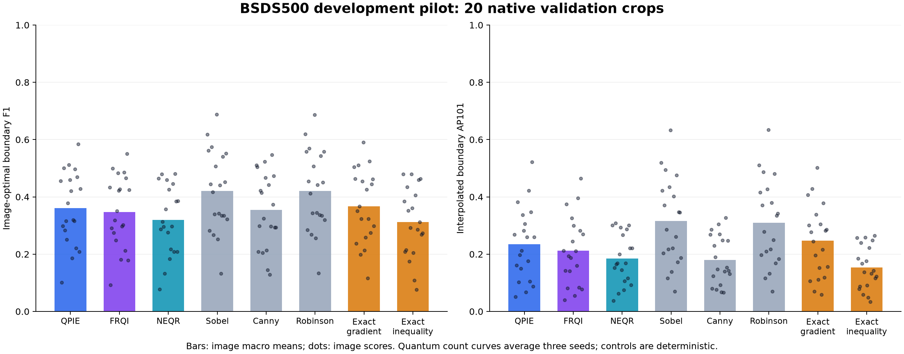
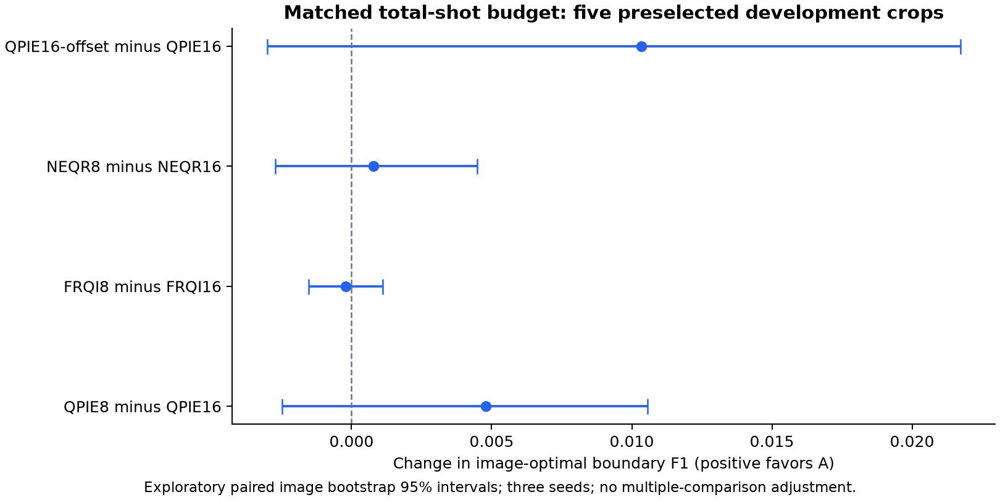
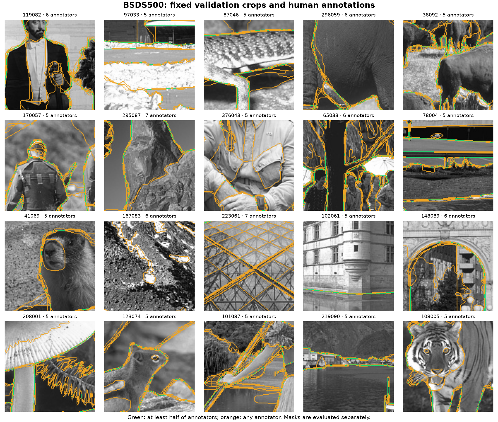

# BSDS500 quantum edge-detection development pilot

On the 20 fixed validation crops, **QPIE16** has the highest quantum mean image-optimal boundary F1 (0.3603). The strongest classical comparator by this metric is **Robinson** (0.4211). These are development results, not test-set claims.

## Data and protocol

Twenty validation image IDs were selected by a fixed hash ranking before opening annotation files. Each uses one native 128×128 center crop, converted to grayscale with no resizing, contrast stretching or smoothing. All human boundary masks remain separate. No test image or test annotation content was downloaded or evaluated.

Three seeds (42, 4242, 424242) were run per configuration. The main 20-image comparison uses 16×16 blocks and 8,192 shots per circuit, with block-minimum subtraction disabled. The first five preselected cases additionally test 8×8 blocks and QPIE block-minimum subtraction. The smaller blocks receive 1,692 shots per circuit: 3,275,712 total shots per crop versus 3,276,800 for 16×16 (a 1,088-shot or 0.0332% shortfall). No label-based shot allocation was used.

## Boundary evaluation

Each output strength map is divided by its own maximum before thresholding (zero maps remain zero). Thus the common threshold is relative to each image, not an absolute calibrated gradient. Canny uses the existing median-based automatic hysteresis settings and returns a binary map; its 31 threshold entries repeat the same operating point, so its AP101 is not a tuned Canny precision–recall sweep.

At 31 fixed thresholds (1/32 to 31/32), predictions are Guo–Hall thinned and matched one-to-one to each annotator using a maximum-cardinality, minimum-Euclidean-distance bipartite assignment. Tolerance is 0.0075 times the diagonal of the scored 124×124 crop; a two-pixel border is excluded. Precision counts predictions matched to any annotator; recall accumulates matched and positive reference pixels over annotators. This avoids the many-to-one credit possible with simple mask dilation.

Matching uses an independently tested SciPy implementation. The initially investigated Higra native matcher terminated its process on minimal identity fixtures in this environment, so it is not used. Results are **BSDS-style crop-scale pilot metrics**, not certified reproductions of the Berkeley MATLAB evaluator.

For each image, matching-count curves are averaged over the three seeds before scoring. Macro best F1 averages the image-specific threshold optima (OIS-style, grid-only). Pooled best F1 pools image counts and selects the best common threshold (ODS-style, grid-only). Neither diagnostic should be quoted as an official ODS/OIS benchmark result. These validation optima are diagnostic; they are not frozen test operating points. Boundary AP101 is the mean precision envelope over 101 recall levels. It is neither the pixel average precision from the SomBench study nor a certified copy of the official BSDS AP integration.

## Main 20-image comparison

| Configuration | Macro best F1 | Pooled best F1 | Boundary AP101 | Operator RMSE |
|---|---:|---:|---:|---:|
| QPIE16 | 0.3603 | 0.3263 | 0.2349 | 14.3921 |
| FRQI16 | 0.3469 | 0.3245 | 0.2121 | 17.2438 |
| NEQR16 | 0.3190 | 0.3157 | 0.1844 | 0.0717 |
| Sobel | 0.4202 | 0.3785 | 0.3157 | — |
| Canny | 0.3542 | 0.3565 | 0.1795 | — |
| Robinson | 0.4211 | 0.3764 | 0.3102 | — |
| Exact-gradient | 0.3670 | 0.3330 | 0.2467 | — |
| Exact-inequality | 0.3119 | 0.3124 | 0.1534 | — |



## Matched-budget study on five fixed cases

| Configuration | Macro best F1 | Boundary AP101 | Operator RMSE |
|---|---:|---:|---:|
| Canny | 0.3889 | 0.1973 | — |
| Exact-gradient | 0.4134 | 0.3039 | — |
| Exact-inequality | 0.3442 | 0.1697 | — |
| FRQI16 | 0.3775 | 0.2656 | 16.0689 |
| FRQI8 | 0.3773 | 0.2598 | 17.0914 |
| NEQR16 | 0.3472 | 0.2030 | 0.0682 |
| NEQR8 | 0.3479 | 0.2049 | 0.0749 |
| QPIE16 | 0.3908 | 0.2824 | 14.4858 |
| QPIE16-offset | 0.4011 | 0.3064 | 9.8896 |
| QPIE8 | 0.3956 | 0.2845 | 15.4990 |
| Robinson | 0.4973 | 0.3962 | — |
| Sobel | 0.4964 | 0.4019 | — |

| A | B | Change in image best F1 | Paired 95% interval |
|---|---|---:|---|
| QPIE8 | QPIE16 | 0.0048 | [-0.0025, 0.0106] |
| FRQI8 | FRQI16 | -0.0002 | [-0.0015, 0.0011] |
| NEQR8 | NEQR16 | 0.0008 | [-0.0027, 0.0045] |
| QPIE16-offset | QPIE16 | 0.0103 | [-0.0030, 0.0217] |

Intervals use 10,000 paired resamples of five image-level means, with a fixed bootstrap seed. They are exploratory and unadjusted for multiple comparisons. Simulator repeats are not treated as independent images.



## Verification

Completed **240 quantum runs** and 100 deterministic classical/control records. Independent replay checked **165,120 circuits** and **786,383,040 simulator shots**. Maximum magnitude discrepancy: 8.53e-14. All saved threshold-count curves and summary metrics were recomputed.

The matcher passed 50 random small-case comparisons against an independent dense assignment solver, along with identity, empty-mask, one-to-one and multi-annotator invariants. Frozen live sources, input identities, encoding qubit counts, preparation offsets/norms, audit identities and shot totals are checked by the verifier. See [verification.json](verification.json).

A separate verifier independently rederived all 20 image and annotation crops from raw assets, checked provenance, recomputed 750 summary metric cells and all four paired bootstrap intervals. See [summary_verification.json](summary_verification.json). All 100 classical/control maps were also regenerated and matched exactly. Regression suites passed 76 tests across the two repositories.

## Interpretation limits and next decision

QPIE and FRQI have the same calibrated intensity-gradient target. NEQR detects four-bit quantized inequality, with a different exact control and different RMSE units. Compare RMSE within each operator track. Human semantic boundaries are not identical to photometric gradients. A good boundary score does not by itself establish a better gradient estimator.

This is a small native-crop validation study with a coarse threshold grid. It cannot be compared directly to published full-image BSDS500 scores or establish generalization to unseen lunar scenes. The three encoding processes ran concurrently; runtimes include audit writes and are not used to rank speed or claim quantum hardware advantage. State preparation uses ideal Aer Initialize.

Use the paired fixed-budget results to choose a development configuration, then confirm it on additional validation images before freezing a full-image test protocol. Keep the test split untouched during this selection.

The measured recommendation is to retain 16×16 blocks as the development baseline: all three smaller-block F1 intervals include zero, and their operator RMSE is higher on these five cases. QPIE block-minimum subtraction improves mean F1 by 0.0103 and lowers gradient RMSE from 14.4858 to 9.8896, but its F1 interval also includes zero. Confirm that option on additional validation images before changing defaults. The classical Sobel/Robinson lead also exceeds the exact unsmoothed gradient control, suggesting that the operator and its spatial filtering deserve investigation alongside shot noise; this pilot does not isolate the cause.

Dataset decision: retain BSDS500 for human-annotated boundary development, while keeping the lunar benchmark as a separate domain check. For a lunar boundary claim, the next useful dataset work is a small, independently traced lunar rim set with product/geographic separation and annotation uncertainty recorded. Natural-image validation and approximate catalog rim masks cannot substitute for that domain ground truth.

## Provenance and reproduction

Source: [BIDS BSDS500 mirror](https://github.com/BIDS/BSDS500), commit `a04b7c6c3a9f0ace74bf205c72a43d32e1c72722`. [Berkeley benchmark guidelines](https://www2.eecs.berkeley.edu/Research/Projects/CS/vision/grouping/resources.html). Attribution: P. Arbeláez, M. Maire, C. Fowlkes and J. Malik, *Contour Detection and Hierarchical Image Segmentation*, TPAMI 2011.

From the FRQI repository, install `requirements-bsds.txt`, then run:

```powershell
.\.venv\Scripts\python.exe data/bsds500_setup.py
.\.venv\Scripts\python.exe experiments/run_bsds_parallel.py
.\.venv\Scripts\python.exe experiments/verify_bsds_summary.py
.\.venv\Scripts\python.exe experiments/bsds_outputs.py
```

The runner resumes only matching frozen protocols. The original serial driver remains `experiments/bsds_pilot.py`; independent replay and metric recomputation are available through `experiments/bsds_pilot.py --verify-only`. Protocol, hashes, selected IDs, annotations and method logs are retained beside this report. Source image terms remain those of the original dataset.

[Quality checkpoints and investigations](quality_review.md)


