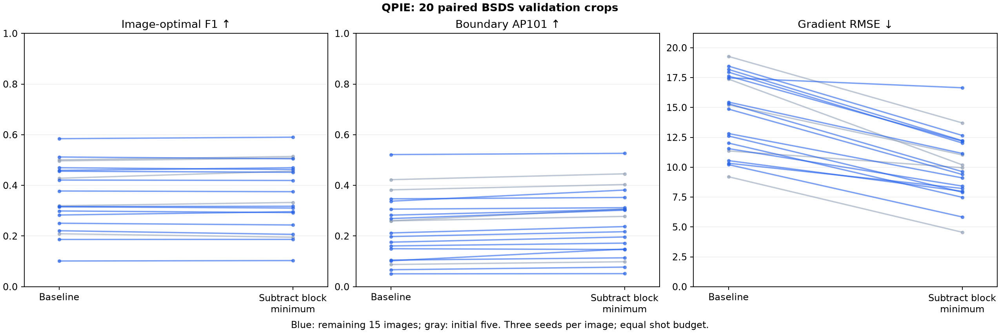

# QPIE block-minimum subtraction: 20-image follow-up

This extends the original five-image experiment to all 20 fixed BSDS500 validation crops. It adds 45 quantum runs and reuses 60 baseline and 15 existing offset runs. The original pilot files and detector defaults are unchanged.

## Paired results

| Images | Metric | Baseline | Subtraction | Difference (subtraction − baseline) | Paired 95% interval |
|---|---|---:|---:|---:|---|
| all20 | best_f1 | 0.3603 | 0.3618 | +0.0014 | [-0.0030, +0.0060] |
| all20 | operator_rmse | 14.3921 | 10.0160 | -4.3761 | [-5.0641, -3.6449] |
| all20 | boundary_ap101 | 0.2349 | 0.2536 | +0.0187 | [+0.0126, +0.0251] |
| remaining15 | best_f1 | 0.3502 | 0.3487 | -0.0015 | [-0.0050, +0.0021] |
| remaining15 | operator_rmse | 14.3609 | 10.0581 | -4.3028 | [-5.0277, -3.5418] |
| remaining15 | boundary_ap101 | 0.2190 | 0.2360 | +0.0170 | [+0.0100, +0.0245] |
| initial5 | best_f1 | 0.3908 | 0.4011 | +0.0103 | [-0.0030, +0.0217] |
| initial5 | operator_rmse | 14.4858 | 9.8896 | -4.5962 | [-6.0724, -2.8850] |
| initial5 | boundary_ap101 | 0.2824 | 0.3064 | +0.0239 | [+0.0150, +0.0363] |

## Protocol and interpretation

The first five images motivated this follow-up. The remaining 15 are reported separately to assess whether the original pattern extends beyond those cases. All 20 are development validation data, not an independent test set. F1 is the primary boundary endpoint; gradient RMSE is a mechanistic secondary endpoint and AP101 is descriptive. Intervals are exploratory and unadjusted for multiple comparisons.

Each comparison uses 16×16 blocks, 8,192 shots per circuit, 400 circuits per image and seeds 42, 4242 and 424242. The only detector option changed is block-minimum subtraction. Native 128×128 crops, separate human annotations, a two-pixel excluded border, per-map maximum normalization, 31 thresholds, Guo–Hall thinning and one-to-one BSDS-style matching are unchanged. These are crop-scale diagnostics, not official full-image BSDS scores.

Per-image F1 and AP101 are computed after averaging matching-count curves across seeds; RMSE is averaged over seeds. Paired 95% percentile intervals use 10,000 image resamples with seed 20261019. Simulator seeds are not treated as independent images. Positive F1/AP differences favor subtraction; negative RMSE differences favor subtraction. All methods still use ideal simulator state preparation; no runtime or hardware advantage is inferred.

## Verification

All 120 paired records were checked: 48,000 circuits and 393,216,000 shots independently replayed. Maximum magnitude discrepancy 0. Source/package/input hashes, audit identities, shot totals, preparation offsets and norms, all boundary-count curves, encoding qubits and RMSE agree. No new data were downloaded or test contents accessed.

See [verification](verification.json), [verified summary](validated_summary.json), [protocol](protocol.json), [run ledger](run_ledger.json) and [quality checkpoints](quality_review.md).

Reproduce from the FRQI repository with `.venv/Scripts/python.exe experiments/bsds_offset20.py`. Use `--verify-only` to replay and regenerate the report without simulations. Dependencies and dataset attribution are inherited from the [original pilot](../bsds_pilot/report.md).

## Follow-up decision

On the remaining 15 images, subtraction changes mean F1 by -0.0015 (95% interval [-0.0050, +0.0021]); this does not resolve the direction of the boundary effect. Across all 20, the change is +0.0014. Remaining-15 gradient RMSE changes by -4.3028 ([-5.0277, -3.5418]).

Keep the current default. Do not claim a reliable improvement in primary boundary F1; further validation or operator/filtering work is needed.

The descriptive AP101 endpoint improves from 0.2349 to 0.2536 on all 20 images (difference +0.0187, interval [+0.0126, +0.0251]). This suggests improved boundary ranking even though the primary image-optimal F1 does not establish a gain. These are distinct outcomes, not a uniform win.

Boundary quality and gradient estimation are separate endpoints. Thresholds are selected on these validation crops; these results establish neither unseen-image performance nor lunar-rim accuracy. Retain BSDS for development and obtain independently traced lunar rims for domain evaluation.

The independent arithmetic verifier checked all image metrics and nine frequency-weighted bootstrap intervals, and reproduced the original baseline and five-image effect. The verified summary corrects a generic raw count label so lower RMSE counts as improvement. Numeric means, intervals and scientific comparisons are unchanged. See [summary verification](summary_verification.json).

After the simulation/replay driver, run `.venv/Scripts/python.exe experiments/analyse_bsds_offset20.py` to reproduce this verified interpretation.
