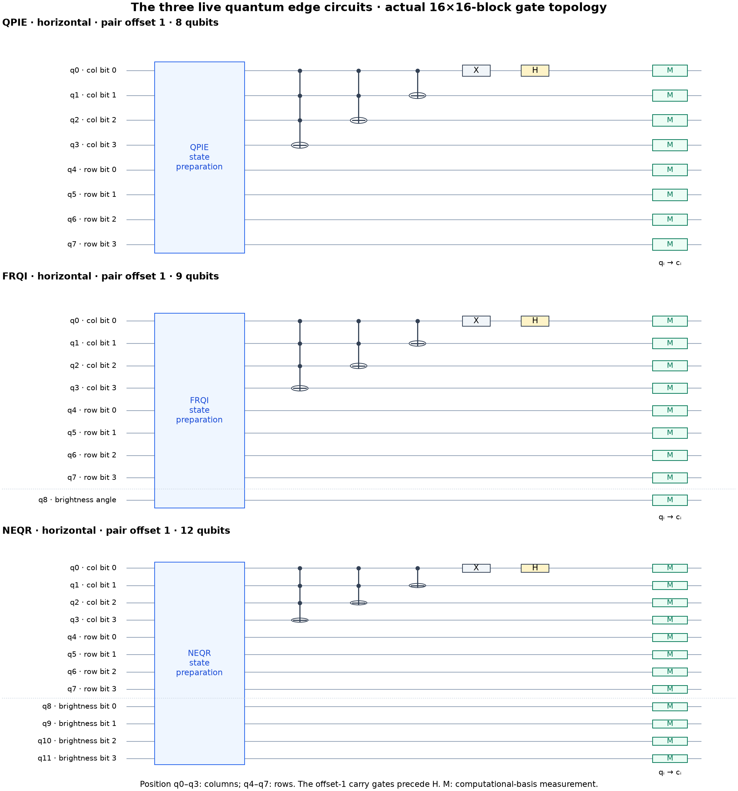
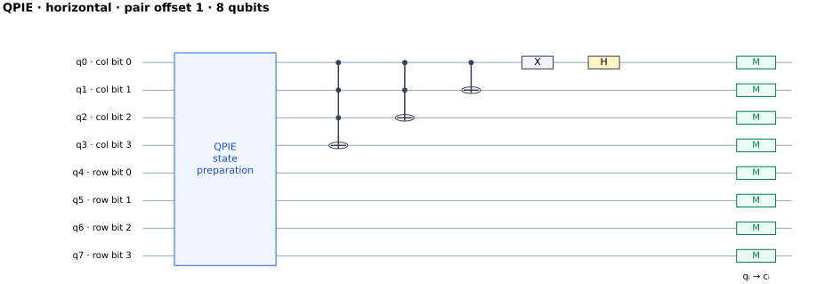
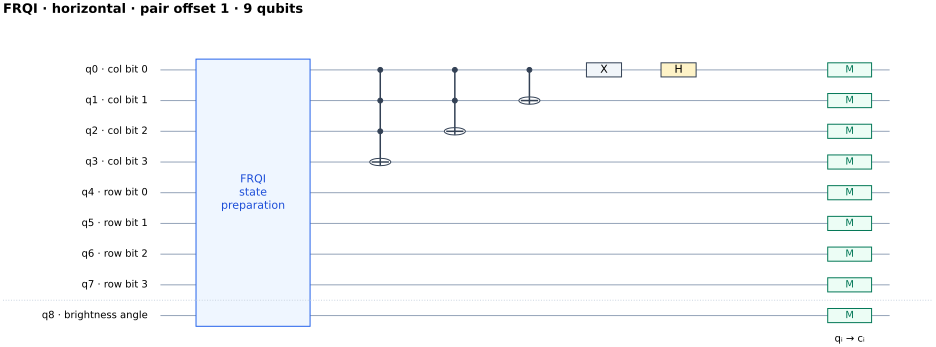
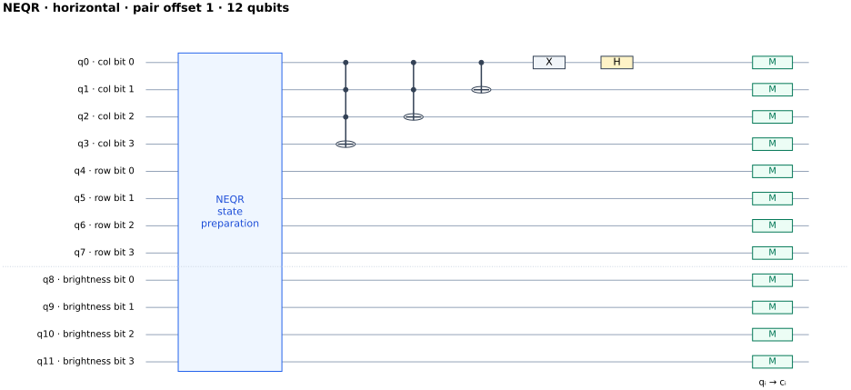

# Quantum circuit atlas: what the three running apps execute

> **Historical NEQR snapshot:** the NEQR diagrams and 12-qubit counts below document the earlier four-bit version. The live NEQR detector now uses eight brightness bits (16 total qubits per 16×16 block). Its current expanded preparation is available at http://127.0.0.1:8769/state_preparation.html. QPIE/FRQI diagrams remain applicable.

The live apps use three encoding families, each with four neighbor-pair passes: **12 circuit variants per block**. This atlas is generated from the actual Qiskit builders on a fixed 16×16 example block from the lunar demo. Circuit structure is identical across image blocks; preparation amplitudes depend on the pixels. These diagrams show native instructions. Preparation is grouped into an `Initialize` block, and independent terminal measurements share a drawing column.



## 1. Registers and gates

For a 16×16 block, 256 positions require eight position qubits. Qiskit's low-order bits are listed first:

| Register | Qubits | Purpose |
|---|---|---|
| Column | q0–q3 | Column coordinate 0–15; q0 is its least-significant bit |
| Row | q4–q7 | Row coordinate 0–15; q4 is its least-significant bit |
| QPIE brightness | No extra register | Brightness is carried by position-state amplitudes |
| FRQI brightness | q8 | Brightness is carried by a qubit's angle |
| NEQR brightness | q8–q11 | Four-bit quantized intensity, 0–15 |

No extra ancilla is allocated by the live detection builders. These are logical qubit counts for these circuits, not hardware resource estimates including error correction or routing.

| Diagram element | Meaning in this project |
|---|---|
| State-preparation block | `Initialize` prepares the chosen normalized image state |
| X | Flips a coordinate bit; the last step of an increment |
| Filled controls connected to ⊕ | CX, CCX or MCX: flip a target when all controls are 1 |
| H | Hadamard: converts a neighboring pair's amplitudes into sum and difference channels |
| M | Measure in the computational basis; qᵢ is recorded into classical bit cᵢ |
| Barrier in source | Compiler boundary/diagram separator, not a physical operation |

The Hadamard maps pair amplitudes `(a,b)` to `((a+b)/√2,(a−b)/√2)`. Equal neighboring states cancel in the difference channel. Accepted outcomes have the selected coordinate's low bit equal to 1. Brightness qubits are measured too, then marginalized by summing outcomes with the same position.

## 2. Why four circuits per block?

A single Hadamard sees disjoint pairs. The second offset exposes the gaps:

| Pass | H target | Neighbor coverage | Diagram by encoding |
|---|---|---|---|
| Horizontal, offset 0 | q0 | Columns (0,1), (2,3), … | [QPIE](qpie_horizontal_0.svg) · [FRQI](frqi_horizontal_0.svg) · [NEQR](neqr_horizontal_0.svg) |
| Horizontal, offset 1 | q0 | Columns (1,2), (3,4), … | [QPIE](qpie_horizontal_1.svg) · [FRQI](frqi_horizontal_1.svg) · [NEQR](neqr_horizontal_1.svg) |
| Vertical, offset 0 | q4 | Rows (0,1), (2,3), … | [QPIE](qpie_vertical_0.svg) · [FRQI](frqi_vertical_0.svg) · [NEQR](neqr_vertical_0.svg) |
| Vertical, offset 1 | q4 | Rows (1,2), (3,4), … | [QPIE](qpie_vertical_1.svg) · [FRQI](frqi_vertical_1.svg) · [NEQR](neqr_vertical_1.svg) |

Offset 1 performs a modular coordinate increment before H. In the four-bit column register its exact gate order is:

```text
MCX(q0,q1,q2 → q3)
CCX(q0,q1 → q2)
CX (q0 → q1)
X  (q0)
H  (q0)
```

The high carry bits are updated before the low bits change. The vertical version substitutes q4–q7. The circuit's modular shift includes a wraparound pair; classical decoding explicitly discards that pair because the last pixel and first pixel are not image neighbors. Valid edges are anchored at the right/bottom neighbor.

## 3. QPIE: brightness as amplitude

**Eight qubits.** The prepared state is `Σᵢ (Iᵢ/C)|i⟩`, with `C² = Σᵢ Iᵢ²`. In the live QPIE app, each block first subtracts its minimum: `Iᵢ = pixelᵢ − block_min`. Neighbor differences are preserved, while the preparation norm changes. The separately reported matched benchmark also tested subtraction disabled.

For a neighboring pair with prepared values `a,b`, its accepted probability is:

```text
p_difference = (a − b)² / (2 C²)
reconstructed squared contrast = 2 C² p_difference
```

Thus QPIE estimates contrast size. The known block norm calibrates measured counts back into intensity units. The all-zero block uses a uniform state, yielding no difference-channel signal; its zero norm also makes the calibrated gradient zero.



## 4. FRQI: brightness as an angle

**Nine qubits:** eight position qubits and one brightness qubit. For `N=256` and `θᵢ=(pixelᵢ/255)π/2`, the prepared state is:

```text
(1/√N) Σᵢ [cos(θᵢ)|0⟩ + sin(θᵢ)|1⟩] ⊗ |i⟩
```

H still acts on a position bit, not on the brightness qubit. Summing both brightness outcomes gives:

```text
p_difference = [1 − cos(θa − θb)] / N
|θa − θb| = 2 asin(sqrt(clip(Np,0,1)/2))
|a − b| = (510/π) |θa − θb|
```

The clipping is the implementation's treatment of finite-shot estimates outside the ideal range. FRQI and QPIE target the same absolute intensity differences, with different encoding, probability laws and sampling behavior. FRQI's position amplitudes are uniform, and it does not use QPIE's minimum-subtraction option in the live app.

The simulator prepares the exact FRQI state with `Initialize`; the live builder does not explicitly loop over per-pixel controlled RY gates. RY-style descriptions are a way to understand angle encoding, not a literal listing of this builder's native operations.



## 5. NEQR: brightness as binary basis states

**Twelve qubits:** eight position qubits plus four brightness bits. The live quantizer is exactly `levelᵢ = floor(pixelᵢ × 15 / 255)`, not integer division by 16. Its state is:

```text
(1/√N) Σᵢ |levelᵢ⟩ ⊗ |i⟩
```

Identical brightness basis states interfere and cancel in the odd-position channel; distinct basis states are orthogonal. After summing over brightness outcomes:

```text
p_difference = 0       if level_a == level_b
p_difference = 1/N     if level_a != level_b
directional response² = N p_difference
```

This live operator estimates **quantized inequality**. A one-level change and a ten-level change have the same ideal directional response. It does not estimate contrast magnitude and does not reconstruct a grayscale image before computing the live edge output. Both axes are combined after measurement. Finite counts make the displayed strengths vary around the ideal responses.

As with FRQI, the live implementation uses `Initialize` to prepare the exact named state; it does not run the older per-pixel explicit NEQR writing circuit described below.



## 6. Initialization is not free

These are measured ideal Aer simulations. Showing one `Initialize` box does not mean arbitrary image loading is a constant-cost hardware gate. The following are real decompositions of this atlas's horizontal-offset-1 example into the requested `u,cx` basis, at optimization level 0:

| Encoding | U gates | CX gates | Resets | Measurements | Circuit depth |
|---|---:|---:|---:|---:|---:|
| QPIE | 283 | 268 | 8 | 8 | 535 |
| FRQI | 539 | 523 | 9 | 9 | 1,045 |
| NEQR | 4,123 | 4,104 | 12 | 12 | 8,207 |

These include preparation and the edge circuit. Counts depend on the image, decomposition and compiler settings. They are not optimal algorithmic lower bounds, routed hardware costs or timing predictions. Resets originate from decomposing `Initialize`; native diagrams retain that instruction as a block.

The actual OpenQASM 3 exports are [QPIE](qpie_primitive.qasm), [FRQI](frqi_primitive.qasm) and [NEQR](neqr_primitive.qasm). Each decomposed premeasurement state was checked against its native circuit, up to global phase.

## 7. From these circuits to the full image

The live apps divide an image into 16×16 blocks with a one-pixel halo and a 14×14 interior. Each block executes all four passes, normally with 8,192 shots per pass. Thus one block uses four circuits and 32,768 shots. A 512×512 image needs `ceil(512/14)² = 1,369` blocks: **5,476 circuits and 44,859,392 shots** per encoding.

Measured counts are decoded, calibrated by the encoding's measurement law, mapped back through offsets and stitched into horizontal and vertical squared responses. The displayed magnitude is `sqrt(horizontal² + vertical²)`, normalized by its global maximum. Otsu thresholding produces the final binary map.

Image preprocessing, known-norm calibration, offset decoding, halo stitching, normalization and thresholding are classical operations. Sobel, Canny and Robinson are independent classical references, not quantum subcircuits. This separates the measured edge evidence from the classical work surrounding it.

## 8. What the gate animation shows

The apps instrument selected actual inference circuits with Aer `save_statevector` checkpoints after native nonmeasurement gates. These snapshots expose amplitudes after preparation, carry gates and H. The final measurement frame comes from actual sampled count dictionaries.

`save_statevector` is simulator instrumentation, not a physical quantum gate or an operation available on an unknown hardware state. Checkpoints are inserted before terminal measurements so Aer retains efficient measurement sampling. The animation is slowed playback of saved checkpoints, not hardware gate timing. These trace-instrumented copies retain the same edge-circuit gate topology.

## 9. Older circuit helpers retained in the repository

These are useful research/teaching utilities, but **none replaces the live NEQR inequality circuit**:

| Helper | What it does | Live app? |
|---|---|---|
| `qpie_encode` | QPIE preparation only; no H-difference/measurement by itself | Preparation utility; live builder prepares the same state directly |
| `qpie_encode_with_ancilla` | QPIE state with an extra q0 ancilla fixed to zero; position bits shift up by one | No |
| `neqr_encode` / `neqr_encode_simplified` | Explicit NEQR preparation: H on positions, temporary X masks for pixel addresses, controlled X writes on intensity bits, then undo masks | No |
| `run_neqr_verify` | Measures the explicit NEQR preparation to reconstruct quantized intensities | No |
| `quantum_gradient_from_neqr` | NEQR preparation and measurement, followed by a **classical** forward gradient of the reconstruction | No; this is the retained hybrid baseline |
| `quantum/tiled.py` | Analytical Born-probability reference and optional multinomial samples | No; this bypasses circuit execution |
| Noise models | Optional simulator channel settings for experiments | Not separate edge circuits; the live apps use ideal simulation |

The explicit NEQR helper uses the opposite register placement from the live builder: intensity bits are low-order, then position bits. The atlas includes a verified [2×2, two-bit explicit NEQR example](legacy_explicit_neqr.txt) and [helper metadata](legacy_helpers.json). The extra-ancilla QPIE helper's prepared state was checked to keep that ancilla at zero. The number of circuits in the live detector remains four per block per encoding.

## 10. Verification and reproduction

All twelve native preparation vectors and post-H states were compared with independent formulas and coordinate-array permutations. All twelve accepted-channel Born laws were checked. Three decomposed primitive circuits preserve their native premeasurement states; both legacy examples also passed state checks. See [verification](verification.json), [QPIE circuit operations](qpie.json), [FRQI circuit operations](frqi.json), [NEQR circuit operations](neqr.json) and [quality checkpoints](quality_review.md).

The diagrams show register order and actual gate order from the builders, with preparation abstracted and terminal measurements grouped. They are schematic scientific figures, not full primitive-gate drawings. Source files are hashed and unchanged. Generate again from the FRQI repository:

```powershell
.\.venv\Scripts\python.exe experiments/showcase_circuits.py
```

The sample is fixed to the first padded block of the existing lunar demonstration. It illustrates real circuits; it does not rerun the full image, benchmark speed or demonstrate hardware advantage.

Reproduction note: this historical generator expects the archived four-bit NEQR source. Running it against the current eight-bit NEQR source will reject the mismatch. Use the current per-version state-preparation viewers for the expanded current circuits.
