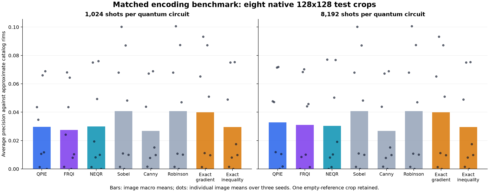
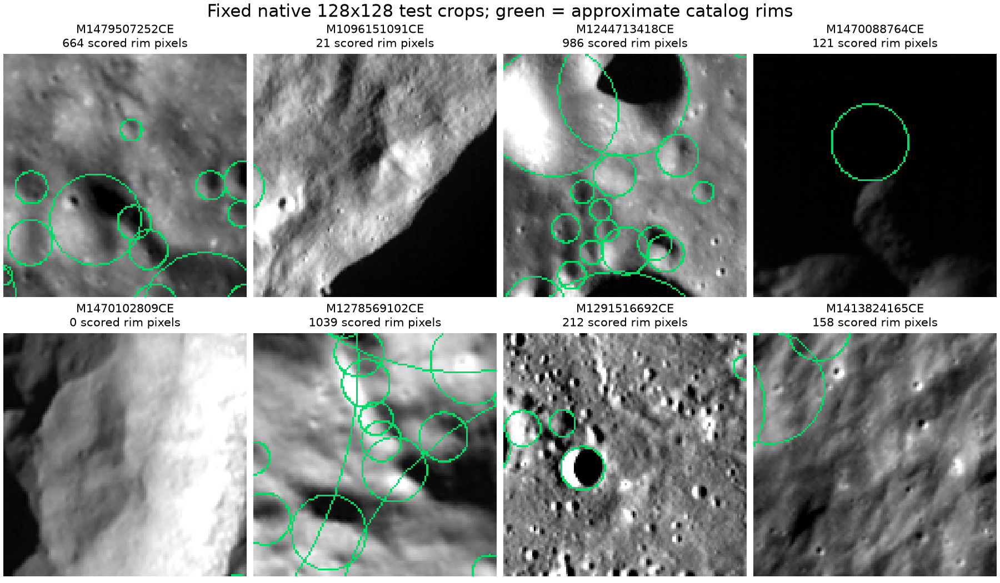

# Matched quantum encoding benchmark

<!-- findings:start -->
## Findings

At 8192 shots, QPIE has the highest quantum mean AP in the frozen eight-case analysis (0.0328), below Sobel (0.0407). In the 6-case subset without detected prior-selection bounds overlap, NEQR has the highest quantum mean AP (0.0373), below Robinson (0.0464). Quantum mean rankings therefore depend on the sample; these small, exploratory comparisons do not establish a universal encoding winner.

Increasing the shot budget improves the sampled operators, but no quantum pipeline surpasses the strongest classical comparator in mean AP in either analysis. The scope is native crops and approximate crater rims, not full-image crater detection or quantum hardware advantage.
<!-- findings:end -->

Eight test-split products excluded from the prior 30-image selection (including their product IDs). One fixed native 128x128 center crop per image; no label-based selection or resizing. This is a crop-scale test-partition study, not a full-image or proven geographically independent benchmark.

All methods receive identical mean-band, full-tile 2-98 percentile grayscale crops. All quantum runs disable block-minimum subtraction, use 16x16 blocks with 14x14 cores, four passes, seeds 42/43/44 and 1024/8192 shots per circuit. There is no smoothing, noise model, or trace capture. Outputs come from actual Aer measurements.

Continuous maps use the same float Otsu implementation. Canny retains its automatic median thresholds. Metrics exclude a 2px crop border for every method. Catalog rims are 1px approximate circular references. No labels tune thresholds. Classical exact-gradient and exact-NEQR-inequality isolate the operators from shot noise.

## Results

Seeds are averaged within image before the eight-image macro average. AP denotes average precision, not trapezoidal PR area. Canny has binary scores. RMSE is in grayscale intensity units for QPIE/FRQI and inequality-response units for NEQR; do not compare these RMSE units across operators.

| Method | Shots/circuit | Exact F1 | 2px F1 | AP | Edge coverage | Operator RMSE | Detector seconds |
|---|---:|---:|---:|---:|---:|---:|---:|
| Canny | 0 | 0.0417 | 0.2164 | 0.0268 | 15.7% | - | 0.0006 |
| Exact-NEQR-inequality | 0 | 0.0552 | 0.2291 | 0.0295 | 51.0% | 0.0000 | 0.0003 |
| Exact-gradient | 0 | 0.0649 | 0.2556 | 0.0399 | 16.9% | 0.0000 | 0.0003 |
| FRQI | 1024 | 0.0214 | 0.1725 | 0.0275 | 2.3% | 18.3133 | 3.9561 |
| FRQI | 8192 | 0.0478 | 0.2424 | 0.0311 | 11.5% | 12.8995 | 11.7551 |
| NEQR | 1024 | 0.0550 | 0.2295 | 0.0299 | 48.0% | 0.1871 | 7.7190 |
| NEQR | 8192 | 0.0552 | 0.2291 | 0.0304 | 51.0% | 0.0611 | 45.8189 |
| QPIE | 1024 | 0.0312 | 0.2065 | 0.0296 | 4.1% | 16.7046 | 2.6393 |
| QPIE | 8192 | 0.0551 | 0.2537 | 0.0328 | 14.6% | 11.1309 | 10.5955 |
| Robinson | 0 | 0.0691 | 0.2623 | 0.0407 | 17.6% | - | 0.0015 |
| Sobel | 0 | 0.0696 | 0.2639 | 0.0407 | 17.8% | - | 0.0008 |

## Paired image bootstrap for AP

10,000 paired resamples of eight image-level means, fixed bootstrap seed 20261019. Intervals are exploratory, unadjusted for multiple comparisons, and limited by the small image sample. Repeated simulator seeds are not treated as independent images.

| A | B | AP difference A-B | 95% interval |
|---|---|---:|---|
| QPIE:1024 | FRQI:1024 | 0.0021 | [0.0003, 0.0047] |
| QPIE:1024 | NEQR:1024 | -0.0003 | [-0.0049, 0.0051] |
| FRQI:1024 | NEQR:1024 | -0.0024 | [-0.0058, 0.0008] |
| QPIE:8192 | FRQI:8192 | 0.0017 | [0.0008, 0.0027] |
| QPIE:8192 | NEQR:8192 | 0.0024 | [-0.0029, 0.0104] |
| FRQI:8192 | NEQR:8192 | 0.0007 | [-0.0047, 0.0083] |
| QPIE:1024 | Robinson:0 | -0.0111 | [-0.0204, -0.0028] |
| QPIE:1024 | Exact-gradient:0 | -0.0102 | [-0.0179, -0.0026] |
| FRQI:1024 | Robinson:0 | -0.0132 | [-0.0226, -0.0044] |
| FRQI:1024 | Exact-gradient:0 | -0.0124 | [-0.0207, -0.0040] |
| NEQR:1024 | Robinson:0 | -0.0108 | [-0.0186, -0.0035] |
| NEQR:1024 | Exact-NEQR-inequality:0 | 0.0004 | [0.0000, 0.0009] |
| QPIE:8192 | Robinson:0 | -0.0079 | [-0.0162, -0.0014] |
| QPIE:8192 | Exact-gradient:0 | -0.0071 | [-0.0136, -0.0015] |
| FRQI:8192 | Robinson:0 | -0.0096 | [-0.0183, -0.0025] |
| FRQI:8192 | Exact-gradient:0 | -0.0088 | [-0.0157, -0.0027] |
| NEQR:8192 | Robinson:0 | -0.0103 | [-0.0180, -0.0033] |
| NEQR:8192 | Exact-NEQR-inequality:0 | 0.0008 | [0.0003, 0.0014] |

## Verification and limits

Completed 184 metric records: 144 quantum runs and 40 deterministic classical/control runs. Quantum totals: 57,600 circuits and 265,420,800 shots.

Each result stores execution totals, protocol hash, input pixel hash and runtime versions; maps and compressed counts are retained for independent recomputation. Counts are checked against requested shots for every circuit, including an independent audit-file verification. Detector timings include count-audit writes and exclude imports, input image I/O, preprocessing, metrics and map serialization. Timings are descriptive ideal-simulator measurements, not evidence of quantum hardware speedup.

NEQR uses four intensity bits and detects inequality, not intensity-gradient magnitude. QPIE and FRQI have the same exact calibrated gradient target but different sampling distributions. Eight center crops cannot establish full-tile crater detection performance, and catalog rims are approximate. Excluding product IDs does not prove geographic independence from all historic development data.

## Data and reproducibility

Dataset: NASA-IBM AI4Science SomBench WAC Crater Detection, revision `20f800becb64a0c7ad314652a683f97f0281fe67`. Attribution: NASA-IBM AI4Science SomBench; Robbins (2019) crater catalog. License: CC BY 4.0.

Run: `.venv/Scripts/python.exe experiments/benchmark_encodings.py`. Resume requires identical protocol and source hashes. Inspect `protocol.json`, `dataset.json`, `runs.csv`, `summary.json` and `verification.json`.

## Selected cases

| Product / tile | Positive reference pixels scored |
|---|---:|
| M1479507252CE_r5360_c360 | 664 |
| M1096151091CE_r10480_c840 | 21 |
| M1244713418CE_r7408_c120 | 986 |
| M1470088764CE_r10600_c632 | 121 |
| M1470102809CE_r10600_c872 | 0 |
| M1278569102CE_r6232_c9696 | 1039 |
| M1291516692CE_r13040_c1080 | 212 |
| M1413824165CE_r7920_c120 | 158 |

## Additional audit and interpretation

Boundary-tolerant F1 uses square binary dilation (Chebyshev pixel tolerance), as implemented by the existing evaluation module. Label-location uncertainty is not included in the bootstrap intervals.

Finite-shot interpretation: for a 16x16 FRQI block, a single accepted count corresponds to a calibrated difference of 117.3 grayscale units at 1024 shots or 40.7 units at 8192 shots. Smaller true differences can still generate a count, but often produce zero observed counts. This is a sampling limitation, not a hard input quantization cutoff. NEQR instead tests inequality between four-bit levels, so its operator and RMSE units differ.

Independent replay decoded all 57,600 count dictionaries (265,420,800 shots) without importing detector/reconstruction code. Maximum magnitude discrepancy: 5.68e-14. See `count_replay_verification.json` and `experiments/verify_encoding_counts.py`.

### Known geographic overlap sensitivity

Metadata bounding-box checks found 2 center crops overlapping full tiles in the previous 30-image selection despite having different product IDs. The frozen eight-image primary analysis remains above. The following exploratory subset excludes these overlaps without selecting replacement cases. The rule uses metadata only and was specified during execution, after initial runs. This checks known prior-selection overlap, not independence from all training data or prior research.

| Benchmark crop excluded from sensitivity | Prior tile with overlapping bounds |
|---|---|
| M1470102809CE_r10600_c872 | M1324611894CE_r10600_c360 |
| M1291516692CE_r13040_c1080 | M1107924572CE_r12136_c720 |

### Results on 6 crops without known prior-selection bounds overlap

| Method | Shots/circuit | Exact F1 | 2px F1 | AP |
|---|---:|---:|---:|---:|
| Canny | 0 | 0.0502 | 0.2672 | 0.0332 |
| Exact-NEQR-inequality | 0 | 0.0686 | 0.2829 | 0.0365 |
| Exact-gradient | 0 | 0.0733 | 0.3052 | 0.0447 |
| FRQI | 1024 | 0.0177 | 0.1969 | 0.0326 |
| FRQI | 8192 | 0.0557 | 0.2936 | 0.0340 |
| NEQR | 1024 | 0.0683 | 0.2834 | 0.0367 |
| NEQR | 8192 | 0.0686 | 0.2829 | 0.0373 |
| QPIE | 1024 | 0.0309 | 0.2426 | 0.0337 |
| QPIE | 8192 | 0.0633 | 0.3032 | 0.0359 |
| Robinson | 0 | 0.0793 | 0.3077 | 0.0464 |
| Sobel | 0 | 0.0796 | 0.3098 | 0.0463 |

### Paired AP intervals on the geographic sensitivity subset

Paired image bootstrap, 10,000 resamples, unadjusted exploratory 95% intervals.

| A | B | AP difference A-B | 95% interval |
|---|---|---:|---|
| QPIE:1024 | FRQI:1024 | 0.0011 | [0.0002, 0.0023] |
| QPIE:1024 | NEQR:1024 | -0.0029 | [-0.0065, 0.0008] |
| FRQI:1024 | NEQR:1024 | -0.0040 | [-0.0075, -0.0008] |
| QPIE:8192 | FRQI:8192 | 0.0018 | [0.0008, 0.0029] |
| QPIE:8192 | NEQR:8192 | -0.0014 | [-0.0039, 0.0011] |
| FRQI:8192 | NEQR:8192 | -0.0033 | [-0.0062, -0.0007] |
| QPIE:1024 | Robinson:0 | -0.0127 | [-0.0243, -0.0026] |
| FRQI:1024 | Robinson:0 | -0.0138 | [-0.0254, -0.0037] |
| NEQR:1024 | Robinson:0 | -0.0097 | [-0.0179, -0.0024] |
| QPIE:8192 | Robinson:0 | -0.0105 | [-0.0203, -0.0021] |
| FRQI:8192 | Robinson:0 | -0.0124 | [-0.0227, -0.0033] |
| NEQR:8192 | Robinson:0 | -0.0091 | [-0.0167, -0.0022] |

### Effect of increasing shots on all eight crops

| Method | AP difference 8192-1024 | Paired 95% interval |
|---|---:|---|
| QPIE | 0.0032 | [0.0007, 0.0062] |
| FRQI | 0.0036 | [0.0005, 0.0086] |
| NEQR | 0.0005 | [0.0000, 0.0010] |

### Timing diagnostics

All timings are retained. The mean detector times in the primary table are sensitive to host scheduling or pauses. The distributions below are descriptive, not a controlled speed benchmark. Runs flagged above five times their group median are listed in `geographic_sensitivity.json`. Their circuits, shot totals and independent count replay are covered by the same verification as all other runs. Causes of elapsed-time outliers cannot be established from retained logs. No runs are excluded from numerical results based on runtime.

| Method | Shots | Median seconds | 25th-75th percentile | Maximum seconds |
|---|---:|---:|---|---:|
| QPIE | 1024 | 1.707 | [1.678, 4.081] | 4.492 |
| QPIE | 8192 | 11.703 | [5.833, 15.579] | 16.187 |
| FRQI | 1024 | 2.918 | [2.751, 6.296] | 6.731 |
| FRQI | 8192 | 7.697 | [7.436, 17.596] | 20.018 |
| NEQR | 1024 | 7.850 | [4.712, 10.333] | 11.861 |
| NEQR | 8192 | 11.161 | [9.713, 22.516] | 763.331 |

### Figures and execution

The matrix was resumed with `experiments/run_encoding_matrix.py`, using one persistent isolated worker per encoding and executing tasks serially in the same fixed randomized order. Previously completed runs were retained only when their protocol hashes matched. Cold/warm in-call behavior can affect descriptive timings; no hardware-speed comparison is claimed. Execution driver identity and hash are in `execution_driver.json`.

Reproduce the final bundle: run `experiments/run_encoding_matrix.py`, then `experiments/verify_encoding_counts.py`, `experiments/plot_encoding_benchmark.py`, and `experiments/analyse_encoding_benchmark.py`.

### Review evidence for this execution

See [quality review](quality_review.md) for Jev checkpoint outcomes and investigations, [independent summary verification](independent_summary_verification.json) for the separate CSV/provenance checks, and [count replay verification](count_replay_verification.json) for the independent measurement reconstruction.
